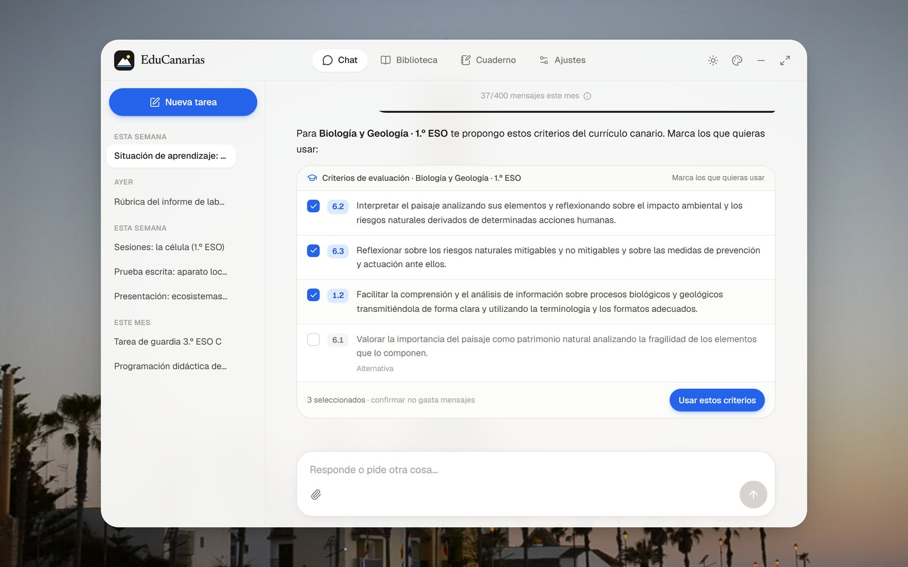
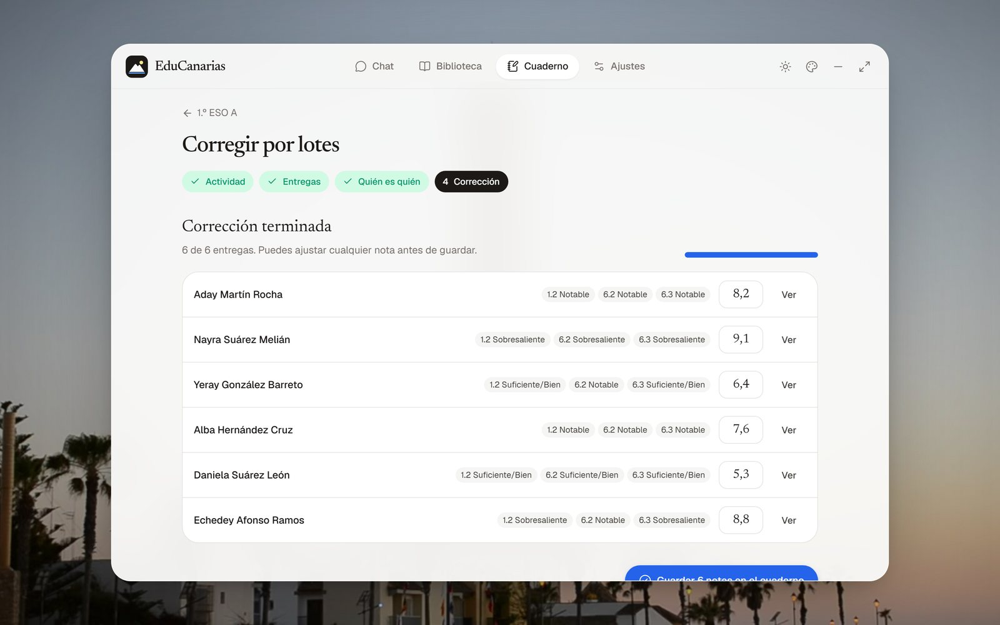
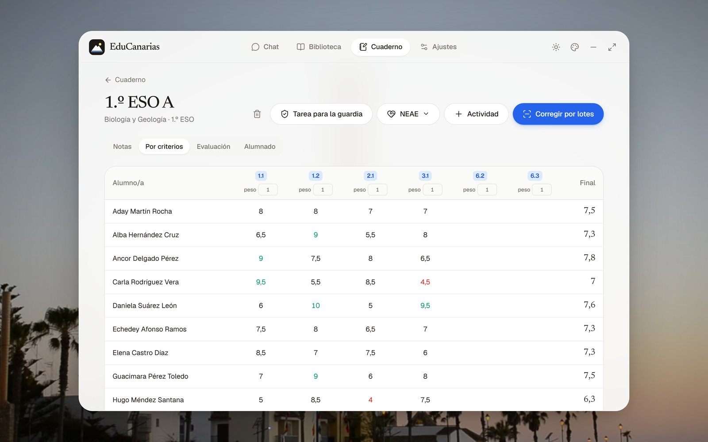
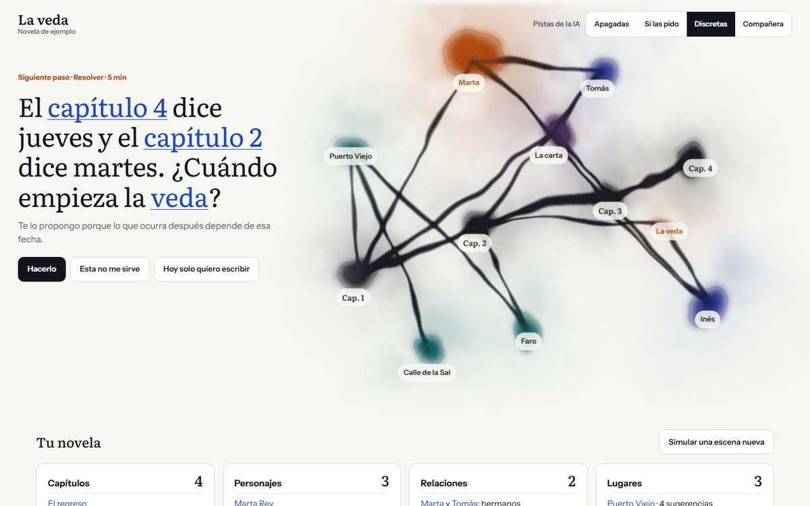
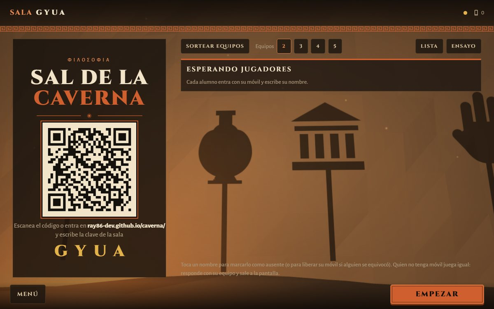
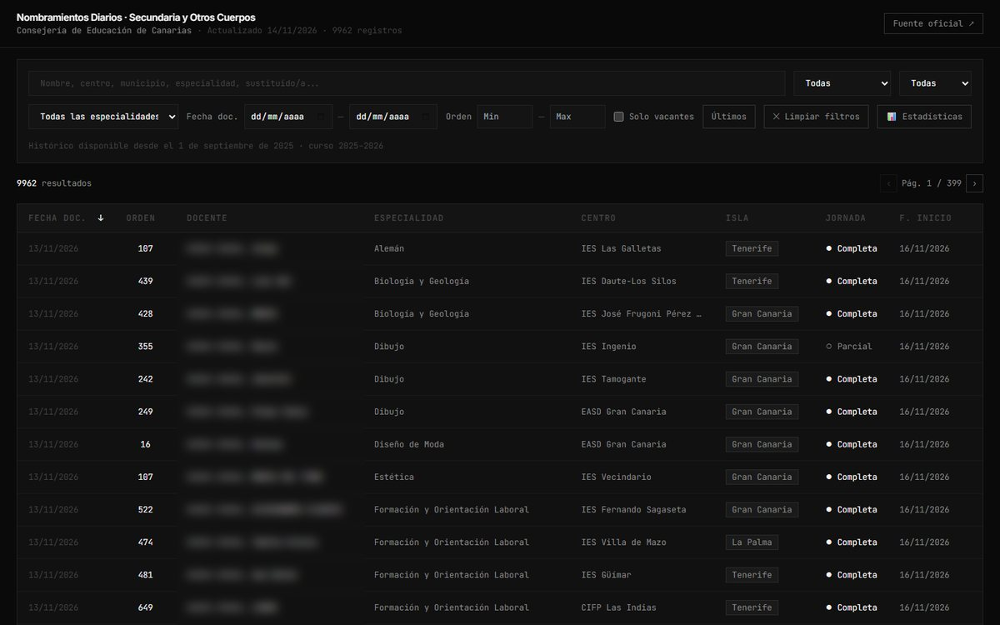
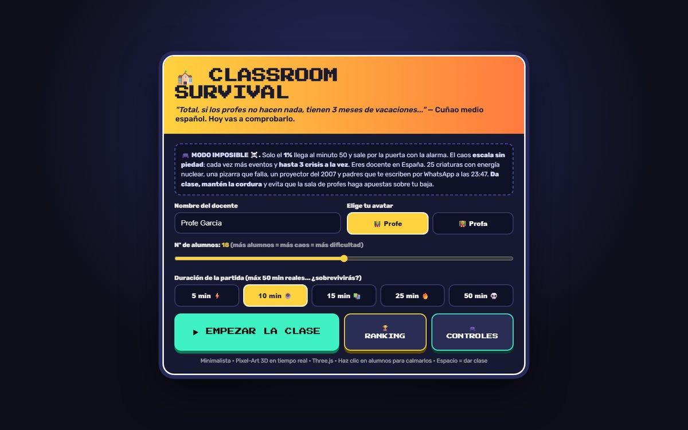

<picture>
  <source media="(prefers-color-scheme: dark)" srcset="https://raw.githubusercontent.com/Ray86-dev/Ray86-dev/main/assets/header-dark.svg?v=3">
  
</picture>

 

  <b>I designed, built and run <a href="https://educanarias.app">EduCanarias</a> on my own: an AI SaaS for teachers, in production, with paying subscribers.</b> 
  Now I want to do the same work inside a product team.

  
  
  
  

 

## Open to work

<table>
<tr><td valign="top"><b>Roles</b></td><td valign="top">Product Engineer · AI Product Engineer · Software Engineer with a product focus</td></tr>
<tr><td valign="top"><b>Where</b></td><td valign="top">Remote first. Based in the Canary Islands, Spain (UTC+0, same time as London and Lisbon)</td></tr>
<tr><td valign="top"><b>Relocation</b></td><td valign="top">Open to Ireland, Germany, Canada and the US. A US role would need visa sponsorship</td></tr>
<tr><td valign="top"><b>Languages</b></td><td valign="top">Spanish (native) · English (C1) · German (B2)</td></tr>
<tr><td valign="top"><b>Contact</b></td><td valign="top"><a href="mailto:rayco@outlook.com">rayco@outlook.com</a> · <a href="https://www.linkedin.com/in/rayco-herrera/">LinkedIn</a></td></tr>
</table>

 

## EduCanarias: an AI product, taken from zero to paying users

Teachers in the Canary Islands spend more hours documenting what they teach than teaching it. I was one of them. **[EduCanarias](https://educanarias.app)** is an agent that plans lessons against the official regional curriculum, grades handwritten work from photos, and keeps a criterion-based gradebook. The teacher always has the last word.

I did all of it: testing with real teachers, product decisions, design, code, infrastructure, billing, support, marketing.

<table>
<tr><td width="50%" valign="top"></td><td width="50%" valign="top"></td></tr>
<tr><td valign="top"><b>Batch grading.</b> Photos of handwritten exams in, a grade per official criterion out, with the evidence for each one.</td><td valign="top"><b>Gradebook.</b> Grades live on the same criteria the agent planned with, weighted per group.</td></tr>
</table>

**What is in it**

- **A grounded agent, with guardrails that are tested.** A scope classifier answers off-topic messages before they spend quota. Tool use is forced, and separate checks catch claims about materials that were never saved and reasoning that leaks into the answer. Each guardrail has its own test file.
- **Real curriculum data as the source of truth.** 3,966 official evaluation criteria and 1,359 rubrics, extracted from government PDFs and with every correction checked against the official text by hash.
- **Cost as a product decision.** Text runs on DeepSeek and handwriting on Gemini, chosen on cost and on how well each reads a teenager's handwriting. Quotas are reserved atomically in Postgres and refunded when a generation fails.
- **The whole business around it.** Stripe subscriptions, free and Pro plans, an admin panel with revenue metrics, email campaigns, an Android app, programmatic SEO pages built from the curriculum database.

| 1,300+ commits | 84k lines of TypeScript | 130 test files | 68 SQL migrations | 18 edge functions |
|:-:|:-:|:-:|:-:|:-:|

`TypeScript` `React 19` `Vite` `Tailwind` `Supabase (Postgres, Auth, Edge Functions)` `Cloudflare Workers` `Stripe` `DeepSeek` `Gemini`

The code is private. **[The case study](case-studies/educanarias.md)** covers the architecture, the decisions and what I would do differently, and I am happy to walk through the repository on a call.

 

## Other work

<table>
<tr>
<td width="50%" valign="top">

<h3><a href="https://github.com/Ray86-dev/ink-writer">Ink Writer</a></h3>
Offline desktop app for writing novels. You write every word; the AI builds character and place sheets from your text, watches for contradictions and cites the passage behind each fact. Runs on a local model or a cloud one.
  
The best place to see how I work: a <a href="https://github.com/Ray86-dev/ink-writer/blob/main/SPEC.md">spec</a>, a <a href="https://github.com/Ray86-dev/ink-writer/blob/main/ROADMAP.md">roadmap</a>, <a href="https://github.com/Ray86-dev/ink-writer/tree/main/docs/adr">21 architecture decision records</a> and CI.
  
<code>Tauri</code> <code>Rust</code> <code>TypeScript</code> <code>Yjs</code> <code>SQLite</code>
</td>
<td width="50%" valign="top">

<h3><a href="https://github.com/Ray86-dev/caverna">Sal de la caverna</a></h3>
A classroom quiz game in real time. The board shows a QR code, students join from their phones, and teams play six rounds of philosophy revision. Built for my own classes.
  
No database and no student data: only ephemeral messages over a realtime channel. The 3D scene turns itself off on weak hardware.
  
<code>JavaScript</code> <code>Supabase Realtime</code> <code>Three.js</code> <code>WebAudio</code>
</td>
</tr>
<tr>
<td width="50%" valign="top">

<h3><a href="https://github.com/Ray86-dev/nombramientos-canarias">Nombramientos Canarias</a></h3>
The regional government publishes teacher appointments as weekly PDFs with no search and no history. A Python pipeline turns them into one table of 9,900+ records that anyone can filter and chart. <a href="https://no-can.vercel.app">Live</a>, updated through the school year.
  
<code>Python</code> <code>pdfplumber</code> <code>Next.js</code> <code>Recharts</code>
</td>
<td width="50%" valign="top">

<h3><a href="https://github.com/Ray86-dev/classroom-survival">Classroom Survival</a></h3>
A 3D browser game about surviving a class as a teacher in Spain, with a world ranking. A joke with a point, and the fastest way to explain my day job. <a href="https://ray86-dev.github.io/classroom-survival/">Play it</a>.
  
<code>Three.js</code> <code>JavaScript</code>
</td>
</tr>
</table>

**Also**

- **[ANOMALÍA](https://github.com/Ray86-dev/anomalia)**: a narrative game of philosophical dilemmas about science. Students play anonymously from their phones, and the projected class view only shows aggregates of five or more. `TypeScript` `Supabase` `PL/pgSQL`
- **[Zen Oposiciones](https://github.com/Ray86-dev/zen-oposiciones)**: a guided study plan for the Spanish teaching exams, with an in-app reader, highlights, AI study aids and the real odds that a prepared topic comes up. `Next.js` `Supabase`
- **[Platón y la caverna](https://ray86-dev.github.io/platon-caverna/)**: an interactive web adventure through Plato for final-year students, in seven stations. `JavaScript`
- **[Opo ULL](https://ray86-dev.github.io/opo-admin-ull/)**: an offline-capable study site with tests, mock exams and spaced repetition for a university civil-service exam. `TypeScript`
- **[Adjudicaciones 2026/27](https://ray86-dev.github.io/adjudicaciones-secundaria-canarias-2026/)**: 31,828 provisional teaching posts, searchable entirely in the browser. `Python` `JavaScript`
- **[BLOB](https://ray86-dev.github.io/BLOB/)**: a minimalist word processor for poets, for the web and Windows. `TypeScript` `Tauri`

 

## How I work

I started programming in December 2025 and I build with coding agents, mainly Claude Code, every day. Most of the code in these repositories was written by an agent. What I do is the part around it:

- **Spec first.** I write what the product must do and for whom before any code exists, then break it into tasks an agent can finish and I can verify.
- **Decisions on record.** Trade-offs go into ADRs and plan documents, so the next session, human or agent, starts from the reasons and not from a guess.
- **Tests as the contract.** Behaviour I care about gets a test before I trust it. Curriculum data is checked against its official source before it reaches production.
- **Small releases, real users.** I ship, watch teachers use it, and change it. EduCanarias was rebuilt from scratch after nine months of that feedback.

 

## Background

I hold a **PhD in philosophy of technology** and I teach philosophy in a public secondary school. Both shaped how I build: I have spent years studying what tools do to the people who use them, and years as the user that education software is made for. That is where my product judgment comes from, most of all in edtech.

 

---

  
    There is also <a href="https://ray86-dev.github.io/">a terminal</a> where Heidegger, Seneca, Shestov, Cioran and Dostoevsky answer back. 
    <i>bauen · wohnen · denken</i>
  

