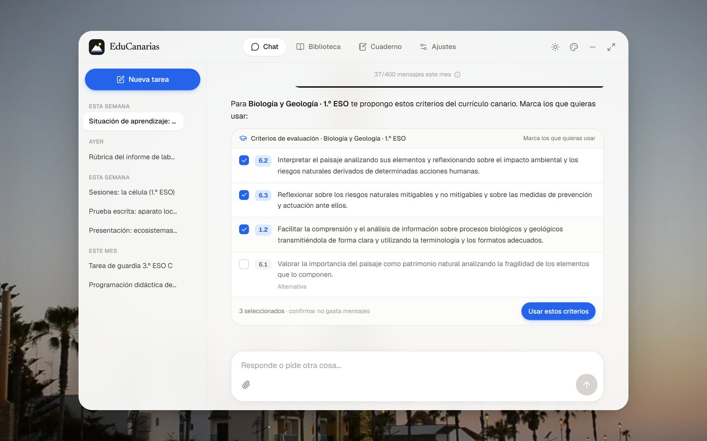
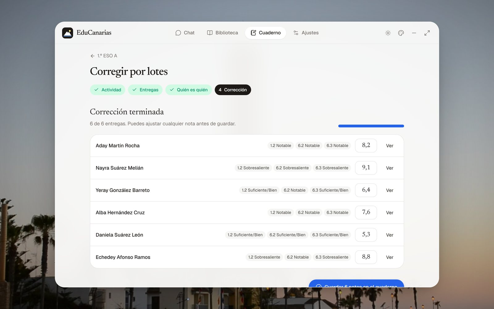
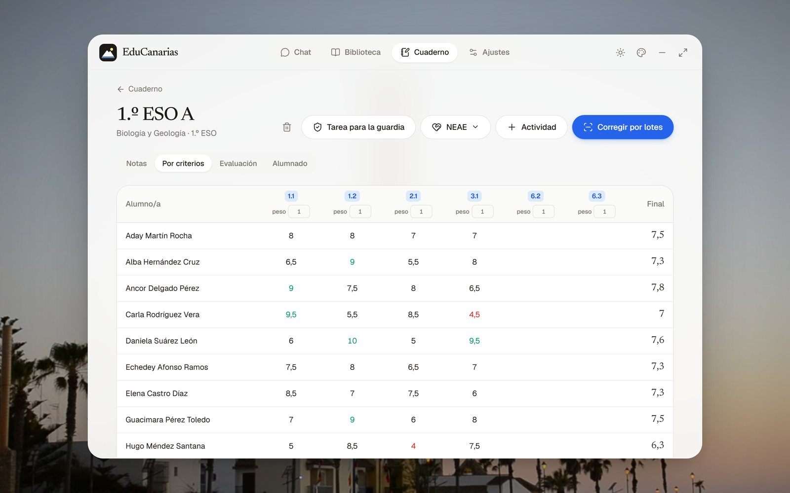
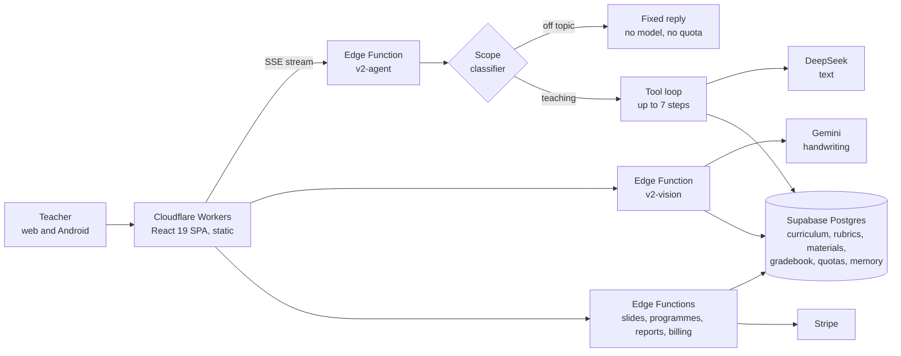

# EduCanarias: case study

**[educanarias.app](https://educanarias.app)** · AI SaaS for teachers in the Canary Islands · in production with paying subscribers · built and run by one person

## The problem

Spain's current education law asks teachers to plan and grade against official evaluation criteria. In practice that means writing long planning documents, building a rubric for every task, and keeping a gradebook where each mark traces back to a criterion code. Teachers do this at night, in Word and Excel, copying text out of 300-page government PDFs.

General chatbots do not solve it. They invent criterion codes, they do not know the regional curriculum, and they cannot read a 13-year-old's handwriting on a photographed exam.

I teach philosophy in a public secondary school, so I had the problem before I had the product.

## What it does

<table>
<tr><td valign="top"><b>Plans</b></td><td valign="top">An agent writes learning units, session plans, rubrics, tests and full-year teaching programmes, using only criteria that exist in the official curriculum.</td></tr>
<tr><td valign="top"><b>Grades</b></td><td valign="top">The teacher photographs a pile of handwritten work. The app matches each paper to a student, grades it criterion by criterion with the official rubric, and shows the evidence. The teacher adjusts and confirms.</td></tr>
<tr><td valign="top"><b>Keeps the gradebook</b></td><td valign="top">Grades land in a gradebook organised by criteria, with a weight per criterion for each group.</td></tr>
<tr><td valign="top"><b>Builds materials</b></td><td valign="top">Slide decks with generated images, handouts, Word and PDF exports, and administrative templates.</td></tr>
</table>

<table>
<tr><td width="50%" valign="top"></td><td width="50%" valign="top"></td></tr>
</table>

## Timeline

<table>
<tr><td valign="top"><b>December 2025</b></td><td valign="top">First commit. I had never programmed before.</td></tr>
<tr><td valign="top"><b>December 2025 to September 2026</b></td><td valign="top">Version 1: 812 commits. A broad set of tools (grader, activity generator, calendar, reports) with Stripe subscriptions and the first paying teachers.</td></tr>
<tr><td valign="top"><b>September 2026</b></td><td valign="top">Version 2: a rewrite around a single agent, started from a written spec. Live on the main domain three days after the first commit, with version 1 kept running on a subdomain.</td></tr>
<tr><td valign="top"><b>September to November 2026</b></td><td valign="top">537 more commits on version 2: batch grading, cross-conversation memory, full-year programmes, an admin panel, an Android app, a security audit and its fixes.</td></tr>
</table>

## Architecture

**Frontend.** Vite, React 19, TypeScript, Tailwind, TanStack Query and Zustand, served as static files from Cloudflare Workers.

**Backend.** 18 Supabase Edge Functions (Deno) on one Postgres database with row-level security, 68 SQL migrations and server-only functions for anything that touches quota or billing.

**Tests.** 130 test files. Every agent guardrail has its own.

## Decisions I would defend

**The curriculum lives in the database, not in the prompt.** The agent cannot write a criterion code from memory. It has to call a tool that reads the official text: 3,966 criteria and 1,359 rubrics extracted from government PDFs. When I corrected that data in production, every changed row was compared with the official text by hash: 1,012 criteria, zero differences.

**A classifier runs before the agent.** A short call labels each message as teaching, small talk, off topic, personal, or risk. Off-topic messages get a fixed reply that costs no model call and no quota. Messages that suggest a risk to a student or to the teacher get a fixed protocol with the right phone numbers, never an improvised answer.

**The agent's rules are data.** Identity, scope and tone live in one document stored in a table and read on each request. I can change the agent's behaviour without a deploy, and the change is versioned in the repository.

**Guardrails are code with tests.** Separate checks stop the agent from claiming it saved a material that does not exist, from leaking its reasoning into the answer, and from charging quota for a button click that only continues a task.

**Models were chosen on cost and fit.** Text runs on DS, which keeps the cost per teacher at cents per month. Handwriting runs on Gemini because it read real student papers better in my tests. The original spec named other models. I changed it after measuring.

**Quota is reserved atomically and refunded on failure.** A Postgres function reserves the quota before the model call and another returns it if the generation fails, so two tabs cannot overspend and an error never costs the teacher a message.

**Static hosting, on purpose.** The app sits entirely behind a login, so server rendering bought nothing. That let me leave the framework the spec proposed and host the frontend for free.

**The rewrite did not break paying users.** Version 2 runs on the same database as version 1, with additive migrations only. Existing subscribers kept their plan and their data, and version 1 stayed online.

**Memory respects the classroom.** The agent remembers durable facts about a teacher's groups and methods, strips student names and diagnoses before saving, shows what it stored, and offers an undo.

## How it was built

I work with coding agents, mainly Claude Code, under spec-driven development. The repository holds the spec, an architecture document, and a plan for each large feature, written before the code. Agents write most of the implementation. I write the requirements, decide the trade-offs, review the result, test it with real teachers, and own what ships.

That is also how one person covered the rest of the business: Stripe billing, an admin panel with revenue metrics, email campaigns, an Android build, promotional video, and public reference pages generated from the curriculum database for search.

## What I would do differently

- **Start from the spec the first time.** Version 1 grew feature by feature and became wide before it was good. Version 2 began with a written spec and one core interaction, and it is the better product.
- **Separate the databases sooner.** Sharing one database kept paying users safe during the rewrite, but every schema change now has to stay compatible with an app I no longer develop.
- **Get other engineers' eyes on it.** Tests, audits and agents catch a lot. They do not replace review from people who have run systems at scale. That is the main reason I want to work in a team.

## Stack

`TypeScript` `React 19` `Vite` `Tailwind CSS` `TanStack Query` `Zustand` `Supabase` `PostgreSQL` `Deno` `Cloudflare Workers` `Stripe` `DeepSeek` `Gemini` `Vitest` `Python`

---

The repository is private because it is a running business. I am glad to walk through the code, the specs and the commit history on a call: [rayco@outlook.com](mailto:rayco@outlook.com) · [LinkedIn](https://www.linkedin.com/in/rayco-herrera/).

[← Back to profile](https://github.com/Ray86-dev)
